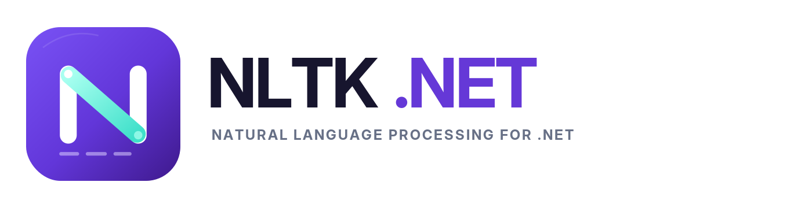

# NltkNet



C# wrappers for [NLTK](https://www.nltk.org/) on .NET 10.

## CPython preview (2.0.0-preview.1)

This branch replaces IronPython with Python.NET and a portable CPython
distribution. Applications do not need an installed Python interpreter, pip,
environment variables, or absolute paths.

Runtime packages are provided for:

| NuGet package | Target |
|---|---|
| `NltkNet.Runtime.osx-arm64` | macOS ARM64, macOS 14+ |
| `NltkNet.Runtime.win-x64` | Windows x64, Windows 10/Server 2019+ (subject to .NET 10 requirements) |
| `NltkNet.Runtime.linux-x64` | Linux x64, glibc 2.28+ and the native dependencies required by .NET 10 |

Alpine/musl, Windows/Linux ARM64 and macOS x64 are not included. Linux is a
glibc runtime, not a fully static executable. Windows validation runs in the
native CI matrix; local cross-packaging alone does not establish support.
Locally verified: macOS ARM64 and Linux x64 (Ubuntu 24.04 Docker, including an
offline non-root run). The Windows package has been cross-built and its publish
assets checked, but a passing Windows CI run is still required before release.

Components:

- `NltkNet`: .NET API and Python.NET 3.2.1 bridge.
- `NltkNet.Runtime.osx-arm64`: CPython 3.12.16 (python-build-standalone
  20261026), NLTK 3.10.4, NumPy 2.5.4 and pinned dependencies.
- `NltkNet.Runtime.win-x64` and `NltkNet.Runtime.linux-x64`: equivalent
  environments with native wheels and CPython libraries for each platform.
- `TestApp`: example application and executable regression checks.
- `PackageSmokeTest`: consumer of the actual local NuGet packages, not project
  references. Build it through the verification command below.

## Build and run from source

On a supported host with the .NET 10 SDK and Bash (Git Bash on Windows):

```sh
bash eng/prepare-runtime.sh
bash eng/prepare-data.sh
dotnet run --project TestApp
dotnet run --project TestApp -- --self-test
```

Preparation downloads checksum-verified dependencies and development datasets.
These are explicit build-time actions; neither `Nltk.Init()` nor the packaged
application downloads or installs anything.

In VS Code, choose **Debug TestApp** and press F5 after preparation.
The Debug build task copies the runtime and prepared datasets to the output.
TestApp and PackageSmokeTest select the host runtime automatically.
For cross-publishing, set `-p:NltkNetRuntimeRid=win-x64` (or `linux-x64`) and
prepare that runtime first.

The preparation script accepts an explicit target and can cross-build packages:

```sh
bash eng/prepare-runtime.sh win-x64
bash eng/prepare-runtime.sh linux-x64
```

It uses a checksum-verified portable **host** Python to install hashed wheels
for the **target**, without executing foreign binaries. CPython, NumPy and
regex wheels are specific to the target architecture. All dependencies are
explicitly locked; pip dependency discovery is disabled while cross-building
to avoid evaluating OS markers against the host. Native builds run `pip check`.
Run target imports and
the package-consumer checks on the target OS before release.

## NuGet consumption

The preview packages are generated locally; they have **not** been published
to nuget.org. Packaging uses the SDK projects.
Build them into a local feed:

```sh
dotnet pack NltkNet/NltkNet.csproj -c Release -o .artifacts/feed
dotnet pack NltkNet.Runtime.osx-arm64/NltkNet.Runtime.osx-arm64.csproj -c Release -o .artifacts/feed
dotnet pack NltkNet.Runtime.win-x64/NltkNet.Runtime.win-x64.csproj -c Release -o .artifacts/feed
dotnet pack NltkNet.Runtime.linux-x64/NltkNet.Runtime.linux-x64.csproj -c Release -o .artifacts/feed
```

Reference `NltkNet` and the matching `NltkNet.Runtime.<rid>`, both at version
`2.0.0-preview.1`. Add the local feed alongside nuget.org (needed for Python.NET
and its dependencies).

```csharp
using NltkNet;

Nltk.Init();
using var tokens = Nltk.Tokenize.WordpunctTokenize("Hello, world!");
Console.WriteLine(string.Join(" | ", tokens.AsNet));

var stemmer = new Nltk.Stem.PorterStemmer();
Console.WriteLine(stemmer.Stem("programming"));
```

Runtime assets flow to normal build and publish outputs via `buildTransitive`.
The runtime archive is verified against its packaged SHA-256, extracted once
into the current user's local application-data directory under
`NltkNet/runtimes/<archive-hash>`, and reused. Extraction uses a cross-process
lock and atomic directory rename. The cache must be writable and its contents
must remain private to the application user.
For managed deployments, `NLTKNET_CACHE_DIRECTORY` can optionally override the
cache location with an absolute writable path; it is not a Python installation
path and is not required for normal use.

## Models and corpora

NLTK code and NLTK datasets are separate dependencies. The runtime package
deliberately does **not** redistribute models or corpora.

`eng/prepare-data.sh` explicitly prepares development data for sentence/word
tokenization, POS tagging, NER and WordNet lemmatization. TestApp includes it in
build/publish output. For another application, provision the required datasets
at deployment time under:

```text
<application directory>/nltknet/data/
  tokenizers/punkt_tab/
  taggers/averaged_perceptron_tagger_eng/
  chunkers/maxent_ne_chunker_tab/
  corpora/words/
  corpora/wordnet/
```

NltkNet sets `nltk.data.path` to this application-local directory, not the
machine's Python/NLTK directories. Keep dataset files non-writable by other
accounts (`chmod -R go-w <dataset-directory>`); current NLTK enforces this.
Missing resources raise the original NLTK error rather than triggering a
download.

Review each model/corpus license before redistributing it. In particular,
the upstream NER model metadata does not specify a redistribution license.
A public dataset NuGet package is deferred until that review is complete.
Corpus APIs may require additional datasets not prepared by the script.

## Migration from IronPython

- Replace `Nltk.Init(paths)` with `Nltk.Init()`. Repeated calls are idempotent.
  The obsolete path overload rejects external interpreter paths explicitly.
- `AsNet` retains the high-level .NET result shapes. Python object results
  now use `PythonValue` rather than `IronPython.Runtime.List`/`PythonTuple`.
- `PythonValue` supports dynamic attributes, method calls, indexing, invocation
  and enumeration; these operations acquire the GIL internally. Python
  scalars become .NET scalars. Managed dictionaries, tuples and sequences are
  converted to native Python containers.
- Results and `PythonValue` implement `IDisposable`. Dispose owned results
  when finished; do not use their Python values afterwards.
- `PythonWrapper.ExecuteScript` executes statements and returns no value;
  use `Evaluate` for expressions. Python snippets must use Python 3 syntax.
- Custom modules can be added explicitly with `Nltk.Py.AddLibPaths(...)`.
  This is not required for the packaged interpreter or NLTK.
- Named dynamic arguments are not supported in this preview; use Python
  expressions for keyword calls.
- CPython is process-global. NltkNet owns its initialization and keeps it alive
  for the process lifetime; shutdown/reinitialization and sharing an interpreter
  initialized by another library are not supported. Do not dispose `Nltk.Py`.
  Separate `PythonWrapper` scopes can be disposed.
- There is no Windows platform spoofing or system IronPython DLL resolver.

These are breaking changes and are versioned as a new major-version preview.

## Package verification

After both preparation scripts:

```sh
bash eng/verify-packages.sh
```

The script packs both projects, restores a separate consumer into an isolated
NuGet cache, publishes it to a path containing spaces and Unicode, and runs it
from an unrelated working directory. It checks automatic runtime discovery,
invalid external Python paths, no-data diagnostics, corruption/missing-runtime
diagnostics, model-backed operations, and offline execution using macOS
`sandbox-exec` network denial on macOS. On Windows/Linux the script explicitly
reports that network denial is not applied; Linux offline validation can run
the published consumer in Docker with `--network none`. Two processes also
initialize concurrently against a fresh isolated cache.

The GitHub Actions runtime-packages workflow runs native preparation, source
regressions and real NuGet consumption on macOS ARM64, Windows x64 and Linux
x64. It uploads tested packages without publishing them to nuget.org.

The shared regression checks exercise tokenization, stemming, lemmatization,
POS, NER, generators, tuples, dictionaries, corpora, classification, exceptions,
repeated initialization, garbage collection and calls from multiple threads.

Only ordinary framework-dependent build/publish is supported in this preview.
Single-file, trimming, Native AOT, other RIDs, automatic upgrades and public
NuGet publication are not claimed. Review all bundled component licenses and
OS support before a public release; notices and upstream license files are
included in the runtime package/archive.

## Runtime licenses

`eng/prepare-runtime.sh` also downloads the matching **full** CPython build,
verifies its pinned SHA-256, and preserves its `PYTHON.json`, license texts and
archive provenance. This requires zstd-capable tar: macOS and Windows system
bsdtar support it; GNU tar on Linux requires the `zstd` executable.
No component is relicensed. Linux intentionally excludes the `_dbm` extension
that statically embeds Berkeley DB; the original metadata is preserved and the
removal is recorded in `runtime-modifications.json`.

### Linux runtime variant

Before preparing a Linux runtime (including cross-packaging from macOS):

```sh
bash eng/build-linux-numpy.sh
bash eng/prepare-runtime.sh linux-x64
```

The first command requires Docker and builds the pinned NumPy source in an
immutable manylinux/glibc 2.28 x64 image with hash-locked build dependencies.
It disables external BLAS/LAPACK and uses NumPy's internal implementations.
The repaired wheel is hash-locked locally; runtime preparation installs it
with `--no-index`, never replacing it with PyPI's Fortran-enabled wheel.
Source URL/hash, build options, builder digest and wheel hash are included in
`numpy-build-provenance.json`. Build tools are not runtime prerequisites.

This variant does not ship Berkeley DB, libgfortran, libquadmath or OpenBLAS.
`dbm`/`shelve` still work through another available backend (including `dbm.dumb`),
but Berkeley DB files cannot be opened through the removed `_dbm` module.
NumPy's CPU baseline is retained without extra dispatch variants. Matrix-heavy
workloads may be slower; tokenization, tagging and NER retain their APIs.
Preparation on Linux audits ELF dependencies and tests dot/solve/SVD and
dbm/shelve fallback. CI and the shared .NET regressions cover the same numerical
operations and the absence of `_dbm`.

### Windows redistribution

The self-contained Windows runtime is retained; no separate VC++ installer is
required by this packaging change. The three Microsoft runtime DLLs are
inventoried by version and hash. Preparation downloads the official VS 2022
Community terms with a pinned SHA-256, preserves their text, and includes
`microsoft/REDISTRIBUTION.txt` and `microsoft-redistribution.json` in `licenses/`.
The Windows NuGet requests license acceptance.

The Community terms provide individual and OSI-open-source development routes
that may be available without a paid Visual Studio subscription. However, the
publisher must actually hold an applicable license and comply with section 4,
including REDIST eligibility and downstream protective-terms requirements.
Neither a CI runner, a copied EULA nor the NuGet acceptance flag establishes
those facts. See [the Windows review](eng/WINDOWS-REDISTRIBUTION.txt) and confirm
entitlement/recipient terms before public distribution. This is the remaining
Windows licensing gate, not a requirement to install Python or specify a path.

Every runtime NuGet includes `licenses/` with:

- `LICENSE.txt`: consolidated original license/notice texts, used by NuGet's
  file-based license metadata. NltkNet's MIT license does not replace these terms.
- `inventory.json`: Python distribution versions/declarations, per-extension
  CPython link/license metadata, original notice hashes and actual native file hashes.
- `CPython-PYTHON.json`, `CPython-provenance.json` and `wheel-install-report.json`:
  upstream metadata and exact archive/wheel download URLs and hashes.
- `cpython/` and `python-packages/`: original notices, including NumPy's native
  library terms and pip's vendored dependency notices.
- `PUBLISHING-REVIEW.txt`: source-form availability and unresolved obligations.

An identical copy is embedded in `python.tar.gz`, so notices remain available
when the runtime is copied to an application and extracted. NLTK models/corpora
are not included. Unmodified tqdm and pip vendored Python sources remain in
site-packages, with their original licenses.

With Python 3.12+ available on the build/verification machine:

```sh
python3 -m unittest discover -s eng -p test_licenses.py -v
python3 eng/verify_licenses.py .artifacts/feed/NltkNet.Runtime.*.nupkg
```

Verification checks license metadata, full-text inclusion, original hashes,
embedded copies and the native binary inventory. Native CI runs these checks.
`--require-publishable` additionally rejects unresolved obligations or missing
legal clearance; it intentionally fails for the current previews.

**Collection is not legal clearance.** The Linux variant removes the previous
Berkeley DB and libquadmath blockers rather than declaring their terms
satisfied. Upstream license files retained for reference may still describe
excluded components; the active inventory and runtime modification record
identify what is shipped. Windows entitlement/recipient terms remain subject
to publisher confirmation. Linux and macOS have no platform-specific blocker
detected by these checks, but that is not an assertion of legal clearance.

## Publishing checklist

The current packages are local previews, not release-ready cross-platform
distributions. Before uploading:

1. Verify ownership of the library and runtime package IDs on nuget.org, choose
   an unused version, and confirm the published platform scope against passing
   native CI results.
2. Resolve the obligations recorded in each runtime's `PUBLISHING-REVIEW.txt`
   and `inventory.json`, review original texts and corresponding-source
   availability, and retain evidence of clearance. The consolidated license
   document and automated inventory are not legal approval. Keep models/corpora
   separate until their redistribution terms are established.
3. Validate pinned dependency versions, vulnerabilities and supported OS
   versions. Repeat package verification from a clean checkout and on the
   minimum supported OS versions. This is a new major-version API migration.
4. Require passing native CI for runtime preparation, build, regression checks
   and actual NuGet consumer verification. Preserve tested artifacts for release;
   do not rebuild them between validation and upload.
5. Commit reviewed source, tag the release and ensure package README/metadata
   match the released version and platform scope. Replace local-feed-only
   instructions when packages become public.
6. Configure a narrowly scoped nuget.org API key in CI secrets, or supported
   trusted publishing. Never put credentials in the repository or chat.
7. Upload the reviewed runtime and library packages, wait for indexing, then
   verify installation and execution from nuget.org in a clean consumer.
   Published package versions cannot be overwritten.

The icon is cropped from the supplied cover and embedded in both packages as
`icon.png`. NuGet metadata includes authors, project/repository URLs and tags.
The cover is displayed here; GitHub's social-preview image must be uploaded
separately in the repository settings.
